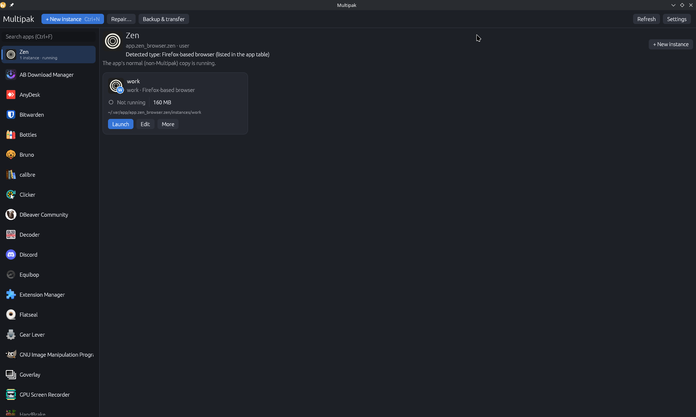
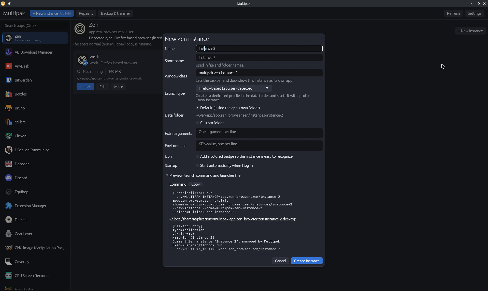

# Multipak

**Run several isolated instances of the same Flatpak app, each with its own data folder.**

"Work" and "Personal" Slack. Three Discord accounts. A separate Chrome for every client.
Multipak creates the instances, gives each one its own launcher and window class so it shows
up as a separate app in your dock and taskbar, and keeps everything easy to back up, move and
clean up again.

It runs on any Linux desktop, in Wayland and X11 sessions, and comes as one binary with a
GUI (egui) and a full command-line interface.

> **Privacy:** Multipak makes no network connections and collects no data. Everything it
> does happens locally, through the `flatpak` command and files in your home folder.

---

## Contents

- [Screenshots](#screenshots)
- [How it works](#how-it-works)
- [Requirements](#requirements)
- [Install](#install)
- [Usage walkthrough](#usage-walkthrough)
- [CLI reference](#cli-reference)
- [Supported app types](#supported-app-types)
- [Files Multipak creates](#files-multipak-creates)
- [Configuration file](#configuration-file)
- [Known limitations](#known-limitations)
- [FAQ](#faq)
- [Why egui with the glow renderer?](#why-egui-with-the-glow-renderer)
- [Why Multipak is not a Flatpak](#why-multipak-is-not-a-flatpak)
- [Contributing](#contributing) · [License](#license)

## Screenshots

| Main window | Creating an instance |
| --- | --- |
|  |  |

The main window lists your installed Flatpak apps on the left (with search). Selecting an app
shows its instances as cards with their icon, running status, disk usage and Launch / Stop /
Edit / More buttons.

## How it works

A Flatpak app keeps everything it stores (settings, data, cache, state, profiles, lock files)
in its app folder, `~/.var/app/<app-id>/`. Multipak gives each instance its own folder, by
default `~/.var/app/<app-id>/instances/<short-name>/`, and starts the app with that folder
**mounted over its app folder**:

```sh
bwrap --dev-bind / / --bind <instance-folder> ~/.var/app/<app-id> -- flatpak run <app-id> …
```

bubblewrap (which Flatpak itself uses, so it is already installed) creates a private,
unprivileged mount namespace in which only that one folder is replaced; everything else on the
system stays the same. Flatpak then hands the sandbox "its" app folder as usual, so the app
writes into the instance folder without knowing it. This works the same way for every app:
no environment variables or app-specific profile flags are involved, and the app's normal copy
keeps using its real folder.

The app type only adds what lets copies run side by side with their own window:

| App type | Extra arguments |
| --- | --- |
| **Electron** (Slack, Discord, Obsidian, Signal, …) | `--class=<wmclass>` |
| **Chromium-based** (Chrome, Chromium, Brave, Edge, Vivaldi) | `--class=<wmclass>` |
| **Firefox-based** (Firefox, LibreWolf, Floorp, Zen, Thunderbird) | `--new-instance --name=<wmclass> --class=<wmclass>` |
| **Generic** (anything else) | none |

Every launch also sets `MULTIPAK_INSTANCE=<app-id>/<short-name>` inside the sandbox, which is
how Multipak tells which instance a running `flatpak ps` entry belongs to.

Each instance gets a launcher in `~/.local/share/applications/` with its own name
(`Slack (Work)`), icon (optionally with a colored badge) and `StartupWMClass`, so it appears in
your app menu and dock as its own app.

Instances (and Multipak itself) can also be **hidden from screenshots, screen recordings
and screen sharing** on KDE Plasma. Each instance is matched by its process, not its window
class, because many apps ignore the class Multipak passes, so only the instances you choose
are hidden, even among copies of the same app:

- a small KWin script (`~/.local/share/kwin/scripts/multipak-capture`, visible under System
  Settings → Window Management → KWin Scripts) asks, for each new window, whether it belongs to
  a hidden instance, and excludes it from capture;
- the answer comes from `multipak capture-service`, which D-Bus starts on demand (through
  `~/.local/share/dbus-1/services/io.github.minasaad47.Multipak.service`) and which exits when
  idle; it reads the `MULTIPAK_INSTANCE` marker of the window's process.

Both are installed only while at least one instance hides from capture, and removed
afterwards. Multipak's own window uses a plain KWin window rule. Other desktops have no
equivalent feature, so there the option is saved but has no effect.

If you choose a data folder **outside** `~/.var/app/<app-id>/`, Multipak shows you the exact
`flatpak override --user --filesystem=<dir> <app-id>` command, asks first, and removes exactly
that permission again when you delete the instance.

## Requirements

- Linux with **Flatpak** installed (user or system installations both work)
- A Wayland or X11 desktop session with OpenGL 2.0 / OpenGL ES 2.0 or newer (any GPU driver,
  including Mesa's software renderer `llvmpipe`)
- Optional: `xdg-desktop-portal` (native file and folder pickers), `xdg-utils` (opening folders),
  `desktop-file-utils` (refreshing the app menu cache)

## Install

### AppImage

Download `Multipak-<version>-x86_64.AppImage` from the
[releases page](https://github.com/MinaSaad47/multipak/releases), then:

```sh
chmod +x Multipak-*-x86_64.AppImage
./Multipak-*-x86_64.AppImage            # opens the GUI
./Multipak-*-x86_64.AppImage list       # CLI commands work too
```

Instance launchers call `/usr/bin/flatpak` directly, not the AppImage, so moving or deleting
the AppImage never breaks them. The release page also has a plain `x86_64` tarball with the
binary, the `.desktop` file and the icon.

### Build from source

Install Rust with [rustup](https://rustup.rs). The repository pins the toolchain in
`rust-toolchain.toml`, so rustup downloads the right version on first build (Rust 1.95 or
newer is required). Then install the build dependencies:

**Fedora**

```sh
sudo dnf install gcc pkgconf-pkg-config libxkbcommon-devel wayland-devel mesa-libGL-devel libxcb-devel
```

**Ubuntu / Debian**

```sh
sudo apt install build-essential pkg-config libxkbcommon-dev libwayland-dev libgl1-mesa-dev \
  libxcb-render0-dev libxcb-shape0-dev libxcb-xfixes0-dev
```

**Arch Linux**

```sh
sudo pacman -S --needed base-devel rustup libxkbcommon wayland mesa libxcb
```

Then build, test and install for your user:

```sh
git clone https://github.com/MinaSaad47/multipak.git
cd multipak
cargo test --workspace
cargo build --release
install -Dm755 target/release/multipak ~/.local/bin/multipak
install -Dm644 packaging/multipak.desktop ~/.local/share/applications/multipak.desktop
install -Dm644 packaging/multipak.svg ~/.local/share/icons/hicolor/scalable/apps/multipak.svg
```

Make sure `~/.local/bin` is in your `PATH`.

## Usage walkthrough

1. **Open Multipak** from your app menu (or run `multipak`). Installed Flatpak apps are listed
   on the left; type to search (**Ctrl+F**).
2. **Select an app.** The header shows the detected launch type and warns you if the app may
   only allow one running copy.
3. **Create an instance** with **＋ New instance** (**Ctrl+N**). Give it a name such as
   "Work". The short name and window class are generated for you and can be changed. You
   can also pick another launch type, a custom data folder, extra arguments (one per line),
   environment variables (`KEY=value`, one per line), a colored icon badge, autostart, and
   hiding the instance from screenshots and screen sharing (KDE Plasma).
   The dialog validates everything as you type and shows a live preview of the exact launch
   command and `.desktop` file.
4. **Launch** it from its card or from your app menu, where it appears as "Slack (Work)". The
   card shows when it is running, and **Stop** closes it.
5. Under **More** on each card: duplicate, open the data folder, copy the launch command,
   recalculate disk usage, clear the cache, back up, restore, and delete.
6. **Delete** removes the launcher, the autostart entry and any folder access Multipak added.
   The data folder is kept unless you tick the box and type the short name to confirm.
7. **Repair…** checks for missing or outdated launchers, missing data folders, lost folder
   access, apps that were uninstalled, and leftover files, and offers one-click fixes.
8. **Backup & transfer** exports your setup as JSON (optionally with data backups) to move to
   another computer, imports it there, or restores a backup as a new instance.

Keyboard: **Tab** moves focus, **Enter** confirms a dialog, **Escape** closes it, **Ctrl+N**
creates an instance, **Ctrl+F** searches, **F5** refreshes. Long jobs (backups, restores,
exports) run in the background with a progress bar and a **Cancel** button.

## CLI reference

The CLI is built into the same binary and uses the same core library as the GUI.
`INSTANCE` accepts `<app-id>/<short-name>`, a short name, or an instance name, as long as it
is unambiguous.

```text
multipak [--verbose] [--log-file] [COMMAND]
```

| Command | What it does |
| --- | --- |
| `multipak` / `multipak gui` | Open the GUI |
| `multipak list [--app ID] [--json]` | List instances with type, status and data folder |
| `multipak apps [--detect] [--json]` | List installed Flatpak apps (optionally with detected type) |
| `multipak create APP_ID NAME [options]` | Create an instance (options below) |
| `multipak launch INSTANCE` | Start an instance in the background; fails if it exits right away with an error |
| `multipak stop INSTANCE` | Stop every running sandbox of an instance |
| `multipak delete INSTANCE [--delete-data [--confirm SHORT_NAME]]` | Delete an instance; data is kept unless `--delete-data` (asks you to type the short name, or pass `--confirm`) |
| `multipak backup INSTANCE [-o FILE]` | Back up the data folder to a `.tar.zst` file |
| `multipak restore FILE [--into INSTANCE \| --as SHORT_NAME] [--grant-access]` | Restore a backup into its instance (recreated if missing), another instance, or a new one |
| `multipak capture on\|off (INSTANCE \| --self)` | Hide an instance, or Multipak's own window, from screenshots, recordings and screen sharing (KDE Plasma) |
| `multipak doctor [--fix [--remove-missing]]` | Check the setup; `--fix` applies the fixes (exit code 2 if problems remain) |
| `multipak export FILE [--with-data]` | Export the setup as JSON, optionally with data backups |
| `multipak import FILE [--rename] [--grant-access] [--no-data]` | Import an exported setup |

`create` options:

| Option | Meaning |
| --- | --- |
| `--slug NAME` | Short name used in file names (default: from the name) |
| `--class WM_CLASS` | Window class (default: `multipak-<app>-<short-name>`) |
| `--strategy electron\|chromium\|firefox\|generic` | Launch type (default: detected) |
| `--data-dir DIR` | Custom data folder |
| `--grant-access` | Allow the `flatpak override` a custom folder needs |
| `--arg ARG` | Extra app argument; repeat for several, use `--arg=--flag` for flags |
| `--env KEY=VALUE` | Environment variable; repeatable |
| `--badge-color '#RRGGBB'` / `--badge-letter X` | Colored badge on the launcher icon |
| `--autostart` | Start at login |
| `--hide-from-capture` | Hide from screenshots, recordings and screen sharing (KDE Plasma) |

Examples:

```sh
multipak create com.slack.Slack Work --badge-color '#e01b24' --badge-letter W
multipak create com.google.Chrome "Client ACME" --data-dir ~/Clients/acme/chrome --grant-access
multipak launch work
multipak backup com.slack.Slack/work -o ~/Backups/slack-work.tar.zst
multipak doctor --fix
multipak export ~/multipak-setup.json --with-data
```

`--verbose` prints debug output; `--log-file` (or `MULTIPAK_LOG_FILE=1`) also writes logs to
`~/.local/state/multipak/multipak.log`. `RUST_LOG` overrides the log levels.

## Supported app types

Multipak picks the launch type from a built-in table
([`crates/multipak-core/data/app_types.toml`](crates/multipak-core/data/app_types.toml)). For
apps not in the table, it checks the app's base app in its Flatpak metadata (for example
`org.electronjs.Electron2.BaseApp`) and well-known files inside the app (`*.asar`, `omni.ja`,
`chrome-sandbox`). Anything else uses the generic type. You can always override the type per
instance.

| Type | Apps in the built-in table |
| --- | --- |
| Electron | Slack, Discord, Discord Canary, Vesktop, Teams for Linux, Obsidian, Signal, Element, VS Code, VSCodium, Bitwarden, Postman, Bruno, MongoDB Compass, Mattermost, Rocket.Chat, Ferdium, YouTube Music, WebCord, Logseq, Joplin, Heroic |
| Chromium-based | Google Chrome, Chrome Dev, Chromium, ungoogled-chromium, Brave, Microsoft Edge, Vivaldi, Opera |
| Firefox-based | Firefox, LibreWolf, Floorp, Zen, Waterfox, Mullvad Browser, Thunderbird, Thunderbird ESR, Betterbird |
| Generic | Telegram Desktop, and any app not detected as one of the above |

Add your own entries without rebuilding in `~/.config/multipak/app_types.toml` (same format;
your entries win). See [CONTRIBUTING.md](CONTRIBUTING.md#adding-an-app-to-the-app-type-table)
to add an app to the built-in table.

## Files Multipak creates

| Path | Purpose |
| --- | --- |
| `~/.config/multipak/instances.toml` | Instance setup (versioned, written atomically) |
| `~/.config/multipak/app_types.toml` | Your additions to the app-type table (optional, you create it) |
| `~/.var/app/<app-id>/instances/<short-name>/` | Default data folder of an instance |
| `~/.local/share/applications/multipak-<app-id>-<short-name>.desktop` | Launcher |
| `~/.config/autostart/multipak-<app-id>-<short-name>.desktop` | Autostart entry (if enabled) |
| `~/.local/share/icons/multipak/<app-id>-<short-name>.png` | Badge icon (if enabled) |
| `~/.local/share/kwin/scripts/multipak-capture/`, `~/.local/share/dbus-1/services/io.github.minasaad47.Multipak.service` | Only on KDE Plasma, while an instance hides from screen capture (enabled in `~/.config/kwinrc`) |
| `~/.config/kwinrulesrc` | Only if Multipak's own window hides from capture: the `multipak-self` rule |
| `~/.local/state/multipak/` | Launch output of each instance, and the log file (if enabled) |
| `~/.local/share/flatpak/overrides/<app-id>` | Only for custom data folders, after you allowed it |

Window size, theme and the last selected app are stored separately by eframe in
`~/.local/share/multipak/`.

## Configuration file

You normally never edit `instances.toml` by hand, but it is plain TOML:

```toml
version = 1

[[instance]]
app_id = "com.slack.Slack"
app_name = "Slack"
name = "Work"
slug = "work"
wm_class = "multipak-slack-work"
strategy = "electron"            # electron | chromium | firefox | generic
# data_dir = "/home/me/Work/slack"   # omit for ~/.var/app/<app-id>/instances/<slug>
extra_args = ["--enable-features=WaylandWindowDecorations"]
autostart = false
created = "2026-11-22T10:00:00Z"

[instance.env]
LANG = "en_GB.UTF-8"

[instance.badge]
color = "#e01b24"
letter = "W"
```

Files from older Multipak versions are upgraded automatically (a copy of the old file is kept
as `instances.toml.v<N>.bak`). Files from newer versions are refused rather than overwritten.

## Known limitations

- **Apps that allow only one running copy.** Many GTK/GApplication and some KDE apps register a
  unique D-Bus name. A separate app folder does not change that name, so starting a
  second copy just opens a new window in the first one. Multipak warns about this when it can
  tell (D-Bus activatable apps, GNOME and KDE runtimes, entries marked in the app table), but
  it cannot work around it. Electron, Chromium and Firefox apps are not affected: their
  single-instance lock lives in the data folder.
- **Window grouping on Wayland.** Electron, Chromium and Firefox get their own window class.
  Under native Wayland, some apps derive their app ID from their own desktop file instead, so
  the dock may group an instance with the normal app even though it runs separately.
  The generic type does not set a window class at all; add `--class=…` as an extra argument if
  the app supports it.
- **Hiding from screen capture** needs KDE Plasma 6. GNOME, Sway and other compositors offer no
  way to exclude a window from capture. Windows are hidden a moment after they open (once the
  helper has answered), so a capture that is already running may record the first frame.
  If you move the Multipak AppImage, run **Repair** so the helper points to the new location.
- **Running detection** reads `/proc` of the sandbox processes. On systems mounted with
  `hidepid`, instances may show as "Not running" even when they are.
- **Folder access** is granted with per-user overrides (`flatpak override --user`) only.

## FAQ

**Is my existing app data touched?**
No. New instances start empty in their own folder. The app's normal copy keeps using
`~/.var/app/<app-id>/` as before.

**Does Multipak need root?**
No. Everything happens in your home folder.

**Do launchers keep working if I uninstall Multipak?**
Yes, they call `flatpak` directly. To remove them, delete the instances first, or remove
`~/.local/share/applications/multipak-*.desktop`.

**How do I move my instances to another computer?**
Use **Backup & transfer → Export setup** (with data, if you want the logins too) and import
the JSON file on the other computer. Custom folders inside your home folder are stored as
`~/…`, so a different user name does not matter.

**Can I use an existing folder as the data folder?**
Yes. Choose it as a custom data folder. For Firefox-based browsers, a folder that already
contains a profile is used as-is.

**The second copy just opened a window in the first one. Why?**
See the first [known limitation](#known-limitations).

**Does it work with apps that are not Flatpaks?**
No. Multipak relies on Flatpak's per-app sandbox folders and `flatpak run`.

**Is anything sent over the network?**
No. Multipak makes no network connections and collects no data.

## Why egui with the glow renderer?

Multipak uses [egui](https://github.com/emilk/egui) through `eframe` 0.37 with the Wayland and
X11 backends enabled, and the **glow** (OpenGL) renderer instead of wgpu. glow needs only
OpenGL 2.0 or OpenGL ES 2.0, which every Linux graphics stack provides: old GPUs, the
proprietary NVIDIA driver, virtual machines, remote desktops and Mesa's software renderer.
wgpu prefers Vulkan and has more failure modes on unusual setups, while a small management app
gains nothing from its extra features. glow also builds faster and gives a smaller binary.
AccessKit (screen reader support) stays enabled.

## Why Multipak is not a Flatpak

Multipak has to run the host's `flatpak` and `bwrap` commands (`flatpak run`, `ps`, `kill`, `override`),
read `/proc` of sandboxed processes, and write launchers into `~/.local/share/applications`,
`~/.config/autostart` and the Flatpak overrides folder. Inside a Flatpak sandbox, all of that
would need `flatpak-spawn --host` plus broad filesystem access, which would defeat the
sandbox, and Flathub would rightly reject it. Multipak is therefore shipped as an AppImage, an
plain binary, or built from source.

## Contributing

Contributions are welcome. [CONTRIBUTING.md](CONTRIBUTING.md) explains the project layout,
how to run the checks, and how to add an app to the app-type table.

## License

Multipak is licensed under the [MIT license](LICENSE).
